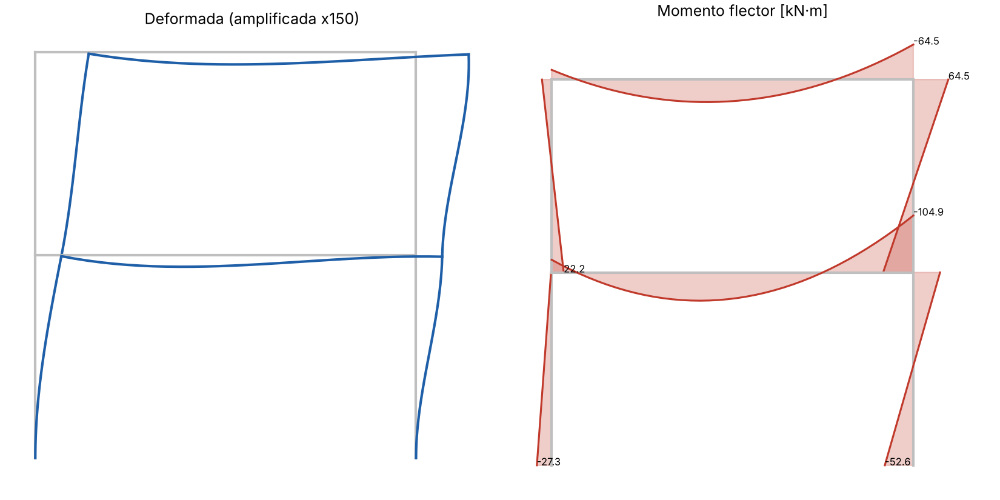

# Análisis matricial de pórticos planos

Implementación del **método de rigidez directa** para pórticos 2D en Python, escrita desde cero con NumPy. La idea fue entender qué hacen por dentro programas como SAP2000 o ETABS cuando uno arma un pórtico: ensamblar la matriz de rigidez global, aplicar condiciones de borde y resolver el sistema `K·U = F`.



## Qué hace

- Elementos viga-columna con 3 GDL por nudo (ux, uy, giro), incluyendo deformación axial.
- Cargas puntuales en nudos y cargas distribuidas uniformes en elementos (convertidas a fuerzas nodales equivalentes por empotramiento perfecto).
- Apoyos empotrados, articulados o de rodillo.
- Desplazamientos, reacciones, fuerzas internas en extremos y momento flector a lo largo de cada elemento.
- Detecta estructuras inestables (matriz de rigidez singular) antes de intentar resolver.
- Gráficos de la deformada (interpolada con funciones de Hermite) y del diagrama de momentos.

## Ejemplo de uso

```python
from portico2d import Portico2D

m = Portico2D()
a, b = m.nudo(0, 0), m.nudo(3, 0)
m.elemento(a, b, E=200e6, A=0.01, I=8e-5)   # kN, m
m.apoyo(a)                                  # empotrado
m.carga(b, Fy=-10)                          # 10 kN hacia abajo
m.resolver()
print(m.resumen())
```

El ejemplo completo (`ejemplos/portico_dos_pisos.py`) modela un pórtico de concreto armado de 2 pisos con columnas de 30×40 cm, vigas de 25×50 cm, carga de gravedad en vigas y fuerzas laterales en cada nivel. Además calcula la deriva elástica de entrepiso como referencia para la Norma E.030.

## Validación

Antes de confiar en el código lo comparé con casos que tienen solución cerrada (`tests/`):

| Caso | Resultado teórico | Verificado |
|---|---|---|
| Voladizo con carga en el extremo | δ = PL³/3EI, θ = PL²/2EI | ✅ |
| Viga simplemente apoyada, carga uniforme | δ = 5wL⁴/384EI, M = wL²/8 | ✅ |
| Viga biempotrada, carga uniforme | M_apoyo = wL²/12, M_centro = wL²/24 | ✅ |
| Pórtico con carga lateral y vertical | Equilibrio global ΣF = 0 | ✅ |
| Viga sin restricción suficiente | Se detecta como inestable | ✅ |

```bash
pip install -r requirements.txt
python -m pytest -q
python ejemplos/portico_dos_pisos.py
```

## Convenciones

- Momento positivo = tracción en la fibra inferior del elemento (convención usual de diseño). El diagrama se dibuja del lado traccionado.
- La carga distribuida `w` se define en ejes locales; para una viga trazada de izquierda a derecha, `w < 0` es carga de gravedad.
- Las unidades deben ser consistentes; en los ejemplos uso kN y m.

## Pendientes

- Liberaciones de momento (rótulas internas) en extremos de elementos.
- Cargas distribuidas trapezoidales.
- Extender a armaduras y pórticos 3D.

## Referencias

- Kassimali, A. *Matrix Analysis of Structures*. Cengage.
- Norma Técnica E.030 Diseño Sismorresistente (Perú).
